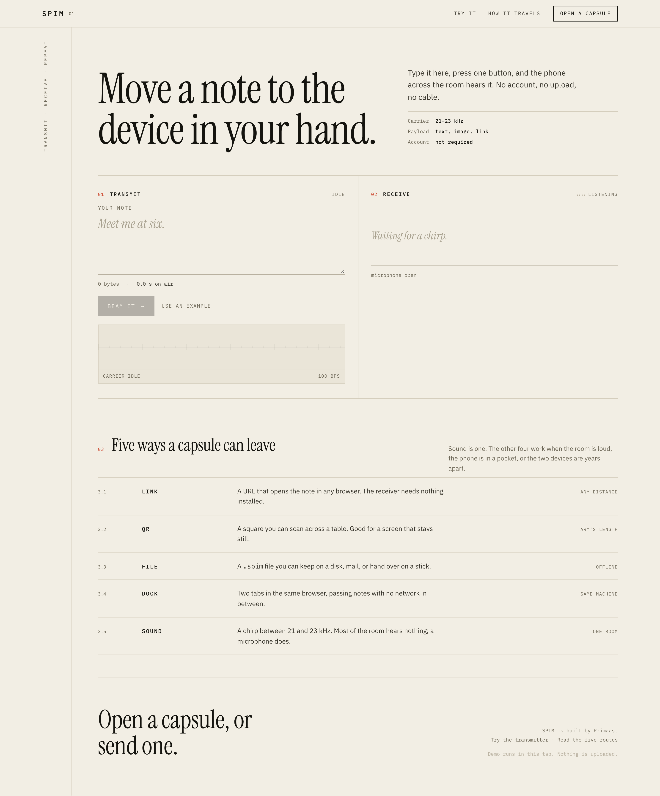

# SPIM — landing experiment

A single-file landing page for SPIM, built to try a different feel from the
current site. Nothing here is deployed and nothing here is connected to the
live site, the API, or Cloudflare Pages.

Open it directly:

```sh
open index.html
# or, if you want a local server:
python3 -m http.server 8901
```



## What is on the page

- A hero at editorial scale: paper, ink, one accent.
- A working transmit/receive demo. You type a note, press `Beam it`, and the
  waveform is drawn from the real UTF-8 bits of that note at the project's
  actual rate (480 samples per symbol, 48 kHz, 10 ms per bit). The airtime
  label is real, not decorative.
- Five delivery routes laid out as a table instead of a card grid.
- No network calls other than the two Google Font families.

The receive panel is a simulation. Sound is not played; the animation is the
transport. A real beam needs a microphone and the microchirp encoder.

## Files

| File | Purpose |
|---|---|
| `index.html` | The whole page: markup, styles, demo script |
| `DESIGN_RULES.md` | The rules this page is held to, so the next pass does not drift |
| `README.md` | This file |

## Design provenance

The rules come from two public repositories:

- [`petergyang/no-ai-slop`](https://github.com/petergyang/no-ai-slop) — writing
  patterns to remove (binary contrasts, colon reveals, throat-clearing, and
  related).
- [`kyoo-147/Better_UI_Not_AI_Slop`](https://github.com/kyoo-147/Better_UI_Not_AI_Slop)
  — interface constitution: intent before layout, inform instead of decorate,
  remove before adding, one screen one job, motion must communicate.
